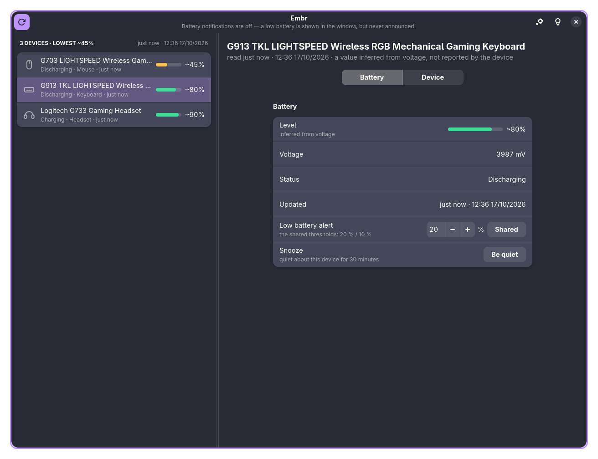

<p align="center">
  
</p>

<h1 align="center">Embr</h1>

<p align="center">A battery monitor for Logitech devices on Linux.</p>

<p align="center">
  <a href="https://github.com/jensend6965/embr/actions/workflows/ci.yml"></a>
</p>

Embr shows what every attached Logitech mouse, keyboard and headset is doing — charge, voltage,
charge state and how it is connected — in a small window, a tray icon and optional desktop
notifications.



*Each device is one row — a glyph, its name on one line and its reading under it. The open device's
pages are tabs across the pane beside the rail, and only the pages that device advertises.*

## Features

* **A reading for every device it can reach** — mice, keyboards and headsets alike, worst battery
  first, with when each reading was taken beside it: how long ago in words, and the clock time and
  day it was taken.
* **Nothing invented.** A device that answered *about itself* but has no reading to give is
  *Connected*; one that said nothing to the question is *Not answering* — a dongle answering for a
  switched-off headset does not count.
* **A percentage the device reports always wins**; one worked out from voltage is marked `~`.
* **A cadence that matches what you are doing** — read at the interval you choose while the window
  is open, no more than once every two minutes with it closed, and read at once when it comes back.
* **It notices a device by itself.** A device that stops answering is shown as *Not answering*
  within seconds, and one that comes back is picked up again. **Rescan** reads now, giving a device
  that has been asleep longer to answer before it is written off.
* **Pages as tabs, and only the pages the device has *and* this window can fill** — a keyboard with
  no DPI feature is never offered a DPI tab, and nothing whose controls are still to be written
  appears at all: today that is the battery and what the device says it is. The tab you pick stays
  picked, per device.
* **A window that uses the width it is given** — the device rail is a column of its own with a
  divider you can drag, and settings rows run the full width with each control at the far right.
* **A level bar in the colour of its level** — green when full, amber in the middle, red when low —
  in the rail and on a device's page alike, and in the tray icon. The percentage beside it stays
  ordinary text; the bar says it once. Switchable off.
* **Tray icon and notifications.** Five tray styles, or one icon per device showing *its* level;
  with nothing chosen there is one icon and it follows the lowest charge.
* **Notifications stay off until you switch them on** — then thresholds, hysteresis, one alert per
  crossing, rate limiting and a snooze.
* **A threshold of its own for any device** you ask for one, for hardware that does not drain at
  the shared rate; `Shared` puts it back with the rest.
* **Close to tray**: closing the window leaves Embr watching, so a low battery is still announced
  with nothing on screen. Turn it off and the close button means what it says; there is a Quit
  button in Settings for a machine whose panel does not draw the tray item.
* **Settings** for all of the above, saved to `~/.config/embr/config.toml` — ordinary text you can
  edit by hand, and the page reads that file, so the two never disagree.

## Build from source

**There is no package yet** — no `.deb`, `.rpm`, Flatpak or Arch package, and nothing in a
repository. Until there is, one script is the whole install:

```bash
git clone https://github.com/jensend6965/embr.git
cd embr
./scripts/install.sh
```

It builds a release binary and puts it where your desktop already looks, so **Embr is in your
launcher** afterwards — and `embr` runs it from a terminal. No root, no flags, and nothing left
running in the background.

**What it needs.** Rust 1.85 or newer ([rustup.rs](https://rustup.rs); a distribution's `rust`
package is usually too old), and three libraries with their headers:

| | |
| --- | --- |
| **GTK 4.12 or newer** and **libadwaita 1.5 or newer** | the window — the build stops before your code compiles if they are older |
| **libdbus-1** | the tray item links the C library (`ksni` has no pure-Rust backend) |
| `pkg-config` | how the two above are found |

| distribution | the packages |
| --- | --- |
| Fedora 40 and newer | `sudo dnf install gtk4-devel libadwaita-devel dbus-devel pkgconf-pkg-config` |
| Arch, Manjaro | `sudo pacman -S --needed base-devel gtk4 libadwaita dbus pkgconf` |
| Debian 13+, Ubuntu 24.04+ | `sudo apt install libgtk-4-dev libadwaita-1-dev libdbus-1-dev pkg-config` |

The script checks for all of them before it builds and names what is missing, rather than letting
`cargo` fail half a minute later. GTK 4 and libadwaita are needed **at runtime** as well, and every
desktop that ships a GNOME-derived shell already has them; Embr takes its font from the desktop,
follows its colour scheme and accent, and ships no fonts and no theme of its own.

**What it installs**

| | |
| --- | --- |
| `~/.local/bin/embr` | the binary |
| `~/.local/share/applications/io.github.jensend6965.Embr.desktop` | the launcher entry, naming that binary by full path so it works even when `~/.local/bin` is not on the session's `PATH` |
| `~/.local/share/icons/hicolor/scalable/apps/embr.svg` | the icon it draws, from `assets/embr.svg` |

`$XDG_BIN_HOME` and `$XDG_DATA_HOME` are honoured when they are set. Nothing else is installed: the
tray icon and the notifications come from the session D-Bus, so there is no service to enable.

`cargo test --workspace` and `cargo clippy --workspace --all-targets` need no hardware and no
display, so a fresh clone can be checked before it is run.

### Updating it

Re-run the same script; it rebuilds and copies the new binary over the old one:

```bash
cd embr
git pull --ff-only
./scripts/install.sh
```

Then start Embr again — a copy that is already running keeps the build it started with, so **quit it
from the tray** first (closing the window is not quitting while *Close to tray* is on).

There are no numbered releases yet and no tags, so `main` is what you are tracking and `git log` is
the changelog. Once a package exists this becomes `dnf upgrade embr` or an AUR update.

### Uninstalling it

```bash
./scripts/install.sh --uninstall
```

It removes the three files above and leaves your settings in `~/.config/embr` alone, so a reinstall
comes back to the same thresholds — delete that directory to forget them too. The udev rule below is
separate: if you installed it, `sudo rm /etc/udev/rules.d/70-embr-hidraw.rules && sudo udevadm
control --reload-rules`. The clone itself is just a directory (`rm -rf embr`).

## Device access

Reading a Logitech device means talking to it over `/dev/hidraw*`, which is root-only by default.
Embr does not want to run as root and installs nothing that stays running, so it ships a udev rule
that hands those nodes to whoever is logged in:

```bash
sudo install -m 0644 rules.d/70-embr-hidraw.rules /etc/udev/rules.d/
sudo udevadm control --reload-rules && sudo udevadm trigger --subsystem-match=hidraw
```

Without that rule Embr starts, finds no devices and shows an empty list.

**What Embr touches:**

| | |
| --- | --- |
| `/dev/hidraw*` of Logitech devices — the `046d` vendor id, the Lenovo-branded receivers, and Bluetooth-attached devices | **read and write.** HID++ has no read-only mode: the same channel carries requests and it is enough to begin a firmware update, which is why the udev rule hands access to the logged-in user only, rather than to everyone |
| `~/.config/embr/config.toml` | read at startup, written when you change a setting |
| The session D-Bus | the tray icon (`StatusNotifierItem`) and notifications (`org.freedesktop.Notifications`) |
| Nothing else | no network access, no telemetry, no root, nothing left running in the background |

## How it is put together

The window is **GTK 4 + libadwaita**, and everything below it is toolkit-free — the crates are split
along that line:

| crate | binary | what it is |
| --- | --- | --- |
| `crates/embr-hidpp` | — | HID++ over `/dev/hidraw*`: discovery, batteries, feature sets |
| `crates/embr-core` | — | the decisions: config, alert policy, cadence, and the view model the window draws |
| `crates/embr-desktop` | — | the tray icons and the notifications — D-Bus, no window toolkit |
| `crates/embr-app` | **`embr`** | the window: the device rail, the pages, the settings and the wiring |

No crate below `embr-app` names a widget, and `embr-app` names no HID++ type: what it needs from the
protocol crate is re-exported by `embr-core`, which keeps a future toolkit move confined to the top
of the stack.

## How this was written

**This project is written with AI.** The person whose name is on the commits sets the
requirements, decides what Embr should do, and does the review and all testing on real hardware;
the code, tests, comments and this file are written by an AI assistant.

So treat it as unreviewed work: no second pair of human eyes has been over it, and the comments
and commit messages are claims rather than evidence.

Practically: read it before you run it, and report what breaks. HID++ has no read-only mode, so
"just trying it" means writing to your devices.

## Roadmap

* **Configuration** — DPI, RGB effects, host switching, then buttons. Those pages exist as stubs and
  say so.
* **Packaging** — a [COPR](https://copr.fedorainfracloud.org) repository for Fedora, which gives
  `dnf install embr` plus a repo file, and an AUR package for Arch. The desktop entry, the icon and
  the udev rule then arrive with the package instead of `scripts/install.sh` copying them into
  `~/.local`.
* **A background daemon**, so notifications keep working with the window closed.
* **Translations**, and a voltage curve measured from our own devices rather than the anchors noted
  under *Licence*.

## Licence

**MIT OR Apache-2.0**, at your option — see `LICENSE-MIT` and `LICENSE-APACHE`.

One value is derived from Solaar (GPL-2.0-or-later): the voltage-to-percentage anchors in
`crates/embr-hidpp/src/battery.rs`, reproduced so that a percentage inferred from voltage agrees
with what `solaar show` prints at the same millivolts. It is stated in the code and here rather than
left implicit, and the roadmap has the exit.
