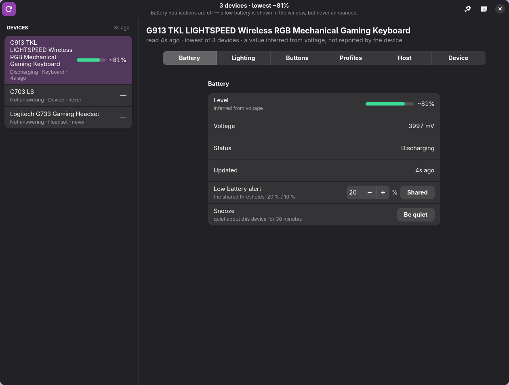

<p align="center">
  
</p>

<h1 align="center">Embr</h1>

<p align="center">A battery monitor for Logitech devices on Linux.</p>

<p align="center">
  <a href="https://github.com/jensend6965/embr/actions/workflows/ci.yml"></a>
</p>

Embr shows what every attached Logitech mouse, keyboard and headset is doing — charge, voltage,
charge state and how it is connected — in a small window, a tray icon and optional desktop
notifications.



*The rail is the devices, at a width of its own; the open device's pages are tabs across the pane
beside it. A device that has stopped answering says so, rather than showing a stale number.*

## How this was written

**This project is written with AI.** The person whose name is on the commits sets the
requirements, decides what Embr should do, and does the review and all testing on real hardware;
the code, tests, comments and this file are written by an AI assistant.

So treat it as unreviewed work: no second pair of human eyes has been over it, and the comments
and commit messages are claims rather than evidence.

Practically: read it before you run it, and report what breaks. HID++ has no read-only mode, so
"just trying it" means writing to your devices.

## What it does

* **Charge for every device it can reach**, headsets included. They report it through a different
  feature than mice and keyboards, and while one is idle there may be nothing to report — Embr says
  so instead of guessing.
* **Nothing invented.** A device that answered *about itself* but has no reading to give is
  *Connected*; one that said nothing to the question is *Not answering* — a dongle answering for a
  switched-off headset does not count; a percentage worked out from voltage is marked `~`, and a
  percentage a device reports itself always wins.
* **Worst battery first**, with the age of each reading beside it.
* **A window that uses the width it is given.** The device list is a column of its own — 340 px,
  and a divider you can drag — so a long device name wraps instead of shoving the pages aside, and
  the pane beside it takes everything left. The open device's pages are tabs across the top of that
  pane, and they are the pages the device itself advertises: a keyboard with no DPI feature is never
  offered a DPI tab. The settings page runs its rows the full width with each control at the far
  right, the way Solaar looks when it is maximised. Everything keeps redrawing while readings
  arrive, but never *moves* you: the tab you picked stays picked, per device.
* **A cadence that matches what you are doing.** While the window is open the devices are read
  at the interval you choose; with the window closed it backs off to no more than once every two
  minutes, and reads everything the moment the window comes back. **Rescan** reads now, and gives
  a device that has been asleep longer to answer before writing it off as *Not answering*.
  Between those sweeps every device is asked one short question — are you still there — every five
  seconds, which is what makes a device switching off visible in seconds rather than at the next
  interval. It is a switch on the settings page and on by default.
* **It notices a device by itself.** Switch a headset off, pick a mouse up, switch a keyboard on,
  plug a receiver back in: a device that stops answering shows up as *Not answering* within a few
  seconds, and one that comes back does too, from the kernel — a HID device that came or went is
  announced by a uevent, which Embr hears and sweeps on at once. Nothing is polled to find out that
  nothing changed: between the short questions above, listening costs nothing.
* **A level bar that says how it is going.** The bar beside a reading is filled in the colour of its
  level — green when full, amber in the middle, red when low — in the rail and on a device's page
  alike, and the tray icon's *level* colour is the same three bands. The percentage beside it keeps
  the ordinary text colour, the bar says it once. A battery with no reading is an unfilled bar in the
  theme's accent colour, and so is every bar when *Colour the level bars* is switched off in
  Settings.
* **Tray icon and notifications.** Five styles, chosen in Settings: a battery whose colour is the
  level, the same battery standing on end, the level itself as digits, a ring that fills as the
  charge rises, and *level and status* — a battery whose fill is the level, with a bolt while the
  device is charging and a warning when it reports a battery fault. Any device can be given an icon
  of its own instead (Settings → Tray): one icon per device, each showing *its* level, the way a
  monitoring overlay puts a readout per sensor on screen. With nothing chosen there is one icon and
  it follows the lowest charge.
* **Notifications** stay off until you switch them on; then they have thresholds, hysteresis,
  one-per-crossing de-duplication, rate limiting and a snooze.
* **A threshold of its own for any device** you ask for one. A headset and a mouse do not drain at
  the same rate, so a device with its own level watches that level instead of the shared pair; set
  it next to the device it belongs to, and `Default` puts it back.
* **Close to tray**: closing the window leaves Embr watching in the background rather than
  quitting, so a low battery is still announced with nothing on screen. Turn it off in Settings
  and the close button means what it says. There is a Quit button there too, for a machine whose
  panel does not draw the tray item.
* **A settings page** for those levels, the tray icon, the close behaviour, the refresh interval
  and the notification switch, and for what the readouts say: the desktop's colour scheme or one of
  your own, whether the level bars are coloured, whether the voltage is shown beside a percentage,
  and whether a percentage worked out from voltage is marked. Saved to `~/.config/embr/config.toml`,
  which is ordinary text you can edit by hand — the page and the file never disagree, because the
  page reads the file.

## Build from source

**There is no package yet** — no `.deb`, `.rpm`, Flatpak or Arch package, and nothing in a
repository. Until there is, one script is the whole install:

```bash
git clone https://github.com/jensend6965/embr.git
cd embr
./scripts/install.sh
```

It builds a release binary and puts it where your desktop already looks, so **Embr is in your
launcher** afterwards — and `embr` runs it from a terminal. No root, no flags, and nothing left
running in the background.

**What it needs.** Rust 1.85 or newer ([rustup.rs](https://rustup.rs); a distribution's `rust`
package is usually too old), and three libraries with their headers:

| | |
| --- | --- |
| **GTK 4.12 or newer** and **libadwaita 1.5 or newer** | the window — the build stops before your code compiles if they are older |
| **libdbus-1** | the tray item links the C library (`ksni` has no pure-Rust backend) |
| `pkg-config` | how the two above are found |

| distribution | the packages |
| --- | --- |
| Fedora 40 and newer | `sudo dnf install gtk4-devel libadwaita-devel dbus-devel pkgconf-pkg-config` |
| Arch, Manjaro | `sudo pacman -S --needed base-devel gtk4 libadwaita dbus pkgconf` |
| Debian 13+, Ubuntu 24.04+ | `sudo apt install libgtk-4-dev libadwaita-1-dev libdbus-1-dev pkg-config` |

The script checks for all of them before it builds and names what is missing, rather than letting
`cargo` fail half a minute later. GTK 4 and libadwaita are needed **at runtime** as well, and every
desktop that ships a GNOME-derived shell already has them; Embr takes its font from the desktop,
follows its colour scheme and accent, and ships no fonts and no theme of its own.

**What it installs**

| | |
| --- | --- |
| `~/.local/bin/embr` | the binary |
| `~/.local/share/applications/io.github.jensend6965.Embr.desktop` | the launcher entry, naming that binary by full path so it works even when `~/.local/bin` is not on the session's `PATH` |
| `~/.local/share/icons/hicolor/scalable/apps/embr.svg` | the icon it draws, from `assets/embr.svg` |

`$XDG_BIN_HOME` and `$XDG_DATA_HOME` are honoured when they are set. Nothing else is installed: the
tray icon and the notifications come from the session D-Bus, so there is no service to enable.

`cargo test --workspace` and `cargo clippy --workspace --all-targets` need no hardware and no
display, so a fresh clone can be checked before it is run.

### Updating it

Re-run the same script; it rebuilds and copies the new binary over the old one:

```bash
cd embr
git pull --ff-only
./scripts/install.sh
```

Then start Embr again — a copy that is already running keeps the build it started with, so **quit it
from the tray** first (closing the window is not quitting while *Close to tray* is on). While an old
copy runs, `ls -l /proc/$(pgrep -x embr)/exe` ends in `(deleted)`; after a restart it does not.

There are no numbered releases yet and no tags, so `main` is what you are tracking and `git log` is
the changelog. Once a package exists this becomes `dnf upgrade embr` or an AUR update.

### Uninstalling it

```bash
./scripts/install.sh --uninstall
```

It removes the three files above and leaves your settings in `~/.config/embr` alone, so a reinstall
comes back to the same thresholds — delete that directory to forget them too. The udev rule below is
separate: if you installed it, `sudo rm /etc/udev/rules.d/70-embr-hidraw.rules && sudo udevadm
control --reload-rules`. The clone itself is just a directory (`rm -rf embr`).

**Packaging is on the roadmap, not done.** The plan is a [COPR](https://copr.fedorainfracloud.org)
repository for Fedora, which gives `dnf install embr` plus a repo file, and an AUR package for Arch —
built with `makepkg`, installed through `pacman -U`, which is the Arch route that does not need a
maintainer to host binaries; a binary pacman repository only if the AUR entry turns out not to be
enough. `scripts/install.sh` is deliberately the same three files a package would install, so a
package wraps it rather than redefining the layout.

## Device access

Reading a Logitech device means talking to it over `/dev/hidraw*`, which is root-only by default.
Embr does not want to run as root and installs nothing that stays running, so it ships a udev rule
that hands those nodes to whoever is logged in:

```bash
sudo install -m 0644 rules.d/70-embr-hidraw.rules /etc/udev/rules.d/
sudo udevadm control --reload-rules && sudo udevadm trigger --subsystem-match=hidraw
```

Without that rule Embr starts, finds no devices and shows an empty list.

**What Embr touches:**

| | |
| --- | --- |
| `/dev/hidraw*` of Logitech devices — the `046d` vendor id, the Lenovo-branded receivers, and Bluetooth-attached devices | **read and write.** HID++ has no read-only mode: the same channel carries requests and it is enough to begin a firmware update, which is why the udev rule hands access to the logged-in user only, rather than to everyone |
| `~/.config/embr/config.toml` | read at startup, written when you change a setting |
| The session D-Bus | the tray icon (`StatusNotifierItem`) and notifications (`org.freedesktop.Notifications`) |
| Nothing else | no network access, no telemetry, no root, nothing left running in the background |

## Built with

| | |
| --- | --- |
| [GTK 4](https://gtk.org) + [libadwaita](https://gnome.pages.gitlab.gnome.org/libadwaita/) | the window, in `crates/embr-app` |
| [`ksni`](https://crates.io/crates/ksni) | the tray icon, over D-Bus (`crates/embr-desktop`) |
| [`notify-rust`](https://crates.io/crates/notify-rust) | desktop notifications (`crates/embr-desktop`) |
| [`serde`](https://crates.io/crates/serde) + [`toml`](https://crates.io/crates/toml) | reading and writing the config file |
| [`libc`](https://crates.io/crates/libc) | talking to `/dev/hidraw*` |

## How it is put together

The window is **GTK 4 + libadwaita** (`gtk4-rs`). It was Slint until the port finished, and the
measurements behind that move — what each toolkit costs and gives — are in
`spikes/004-gtk4-gui/README.md`. Everything below the window is toolkit-free, and the crates are
split along that line:

| crate | binary | what it is |
| --- | --- | --- |
| `crates/embr-hidpp` | — | HID++ over `/dev/hidraw*`: discovery, batteries, feature sets. One dependency, `libc` |
| `crates/embr-core` | — | the decisions: config, alert policy, cadence, and the view model the window draws |
| `crates/embr-desktop` | — | the tray icons and the notifications — D-Bus, no window toolkit |
| `crates/embr-app` | **`embr`** | the window: the device rail, the pages, the settings and the wiring |

No crate below `embr-app` names a widget, and `embr-app` names no HID++ type: what it needs from the
protocol crate is re-exported by `embr-core`, which is what keeps a future toolkit move confined to
the top of the stack.

## Development

```bash
cargo test --workspace                    # no hardware and no display needed
cargo clippy --workspace --all-targets    # keep this silent
```

## Roadmap

* **Configuration** — DPI, RGB effects, host switching, then buttons.
* **Packaging** — a COPR repository for Fedora and an AUR package for Arch (see *Build from
  source* above). The desktop entry, the icon and the udev rule then arrive with the package
  instead of `scripts/install.sh` copying them into `~/.local`, and a systemd user unit would give
  the "keeps watching with the window closed" half a proper home.
* **A background daemon**, so notifications keep working with the window closed.
* **Translations**, and a voltage curve measured from our own devices rather than the one noted
  below.

## Licence

**MIT OR Apache-2.0**, at your option — see `LICENSE-MIT` and `LICENSE-APACHE`.

One thing worth knowing:

* **One value is derived from Solaar** (GPL-2.0-or-later): the voltage-to-percentage anchors in
  `crates/embr-hidpp/src/battery.rs`, reproduced so that a percentage inferred from voltage agrees
  with what `solaar show` prints at the same millivolts. It is stated in the code and here rather
  than left implicit, and the roadmap has the exit — measuring that curve from our own devices.
