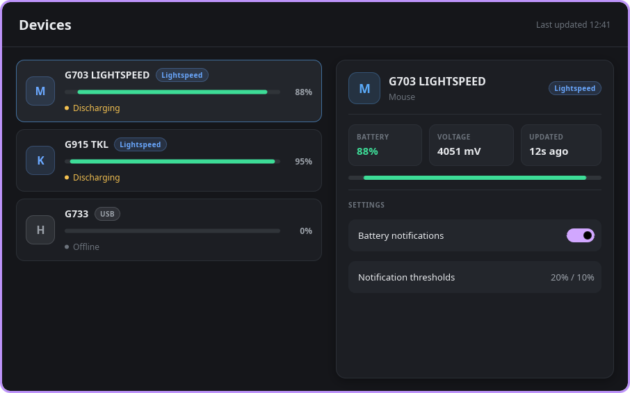

# Spike 002a — Slint (Rust) GUI prototype

A faithful build of the Solaar-modern main window ("Devices") in **Slint 1.18.1** +
Rust, to judge whether the toolkit can produce a modern, current-looking Linux
desktop UI for the rewrite.



*`screenshot.png` — 906×566 PNG (the 900×560 window plus KWin's 3 px shadow
margin), captured with `spectacle -a -b -n -o screenshot.png` while the window
was mapped.*

## What was built

| File | Lines | Purpose |
|---|---:|---|
| `ui/app.slint` | 462 | Entire UI: theme tokens, window, device list, details card, custom components |
| `src/main.rs` | 57 | Window creation, hardcoded `Device` model, instrumented `show()` |
| `build.rs` | 3 | `slint_build::compile("ui/app.slint")` |
| `Cargo.toml` | 11 | 1 normal dep (`slint`), 1 build dep (`slint-build`) |

UI contents (all present and visible in the screenshot):

- Header: "Devices" left, "Last updated 12:41" right, hairline divider.
- Three device rows in a real `ScrollView`: leading monogram icon tile,
  name, connection badge (`Lightspeed` ×2, `USB`), full-width battery bar,
  percent at the right, coloured status dot + status text
  (G703 88 % Discharging, G915 TKL 95 % Discharging, G733 0 % Offline).
  Clicking a row re-binds the details card (live model → UI binding).
- Details card: icon, name, kind, connection badge, three stat tiles
  (BATTERY 88 % / VOLTAGE 4051 mV / UPDATED 12s ago), a large battery bar,
  and a SETTINGS area with "Battery notifications" (a real animated
  `Switch` from `std-widgets`) and "Notification thresholds 20 % / 10 %".
- Dark theme, rounded cards, subtle borders, drop shadow, muted secondary text.

## Measurements

All numbers from this machine (CachyOS, 16 cores, Wayland/KWin, rustc 1.99.0,
`CARGO_TARGET_DIR` unset so the build ran in the spike's own `./target`).

| # | Metric | Value | Exact command |
|---|---|---|---|
| 1 | Cold release build | **51.03 s** wall (user 11 m 37 s, sys 25.6 s, 16 cores) | `cargo clean` then `time cargo build --release` |
| 2 | Dependency count | `cargo tree --edges normal \| wc -l` = **939** lines (**342** unique crates); direct deps in `Cargo.toml` = **2** (`slint`, `slint-build`) | `cargo tree --edges normal \| wc -l` |
| 3a | Binary size (before strip) | **29 989 504 B** (28.6 MiB) | `ls -l target/release/devices` |
| 3b | Binary size (after strip) | **22 972 520 B** (21.9 MiB) | `strip target/release/devices; ls -l target/release/devices` |
| 4 | Resident memory (VmRSS) | **89 340 kB** then **89 340 kB** (5 s apart, after idle); 18 threads | `grep VmRSS /proc/<pid>/status` |
| 5 | Startup to window | **25–26 ms** (5 runs: 26, 25, 25, 25, 25) | see below |
| 6 | Screenshot | `screenshot.png`, 906×566 PNG, 50 569 B | `spectacle -a -b -n -o screenshot.png` |
| 7 | Extra system libraries | none beyond base desktop libs | `ldd target/release/devices` |

**Startup method (important — the obvious method lies here).**
`kineticwe_windowprop` takes ~2.5 s per invocation on this host, so polling it
for the window yields garbage (~6.4 s measured that way — that was the probe,
not the app). Instead the app prints `WINDOW_SHOWN_MS` (ms since the Unix epoch)
immediately after `ui.show()` returns, and the launcher stamps `date +%s%N`
immediately before spawning; the delta is the reported figure
(`measure_startup.sh`). Both timestamps come from the same `CLOCK_REALTIME`
epoch, so the launcher's fork/exec latency (~10–35 ms) is included in the
`launcher_ms_total` column of the raw output, not in `startup_ms`.

**`ldd` output (full):**

```
linux-vdso.so.1, libfontconfig.so.1, libgcc_s.so.1, libm.so.6, libc.so.6,
ld-linux-x86-64.so.2, libfreetype.so.6, libexpat.so.1, libz.so.1,
libbz2.so.1.0, libpng16.so.16, libbrotlidec.so.1, libbrotlicommon.so.1
```

Only fontconfig/freetype and their compression/image deps — i.e. what any
desktop font stack already provides. **No GTK, no Qt, no webkit, no X11 client
libs.** Rendering is native (femtovg/OpenGL via winit; the software renderer is
also compiled in and can be selected with `SLINT_BACKEND=winit-software`).

## Answers to the review questions

**(a) How easy was the UI to express, and how many lines?**
Pleasant — the declarative approach fits this screen almost perfectly. Rounded
cards, nested row layouts, a model-driven `for` loop, string interpolation
(`"\{device.percent}%"`), conditional colours, and selection state all fall out
of the language without imperative code; the whole 3-row list + details card is
462 lines of `.slint` (much of it whitespace) plus 58 lines of Rust glue. Two
real gotchas cost iterations:
1. In 1.18 `alignment` on a layout is the **main-axis** alignment (CSS
   `justify-content`), *not* the cross axis. My first render had every row
   horizontally centred and the stretch spacers collapsed (title overlapping
   "Last updated"). The correct property is `cross-axis-alignment` — after that
   the layout came out as designed.
2. Globals' helper functions must be declared `public pure function` when called
   from other components; without `public` you get a warning that the docs say
   will become an error.

Everything else was first-try correct, including two-way bindings
(`checked <=> root.battery-notifications`) and the `drop-shadow-*` card shadow.

**(b) Real switch / scrollable list / dark-light theming out of the box?**
Yes to all three, from `std-widgets`:
- **Switch** — real widget with thumb animation, hover/pressed states, focus
  ring, keyboard activation and `accessible-role: switch` semantics. Used as-is.
- **Scrollable list** — `ScrollView` (used here) plus `ListView` /
  `StandardListView` with recycling and `bring-into-view`. Real scrolling, lazy
  item instantiation.
- **Dark/light theming** — `Palette.color-scheme = ColorScheme.dark` re-points
  the whole widget style at its dark palette; four complete built-in styles ship
  (Fluent, Cupertino, Material, Cosmic). I set it in `init => { ... }` and got a
  coherent dark theme for the stock Switch for free. Note that a fully bespoke
  look (like the card/pill styling here) is hand-written — there is no CSS.

**(c) Blockers for a production app?**
No hard blocker, but four gaps to plan for:
- **Tray icon: built in.** `system-tray` is a *default* feature of the `slint`
  crate in 1.18 and the API (`SystemTrayIcon`) exists — a tray app can be built
  with no extra dependency. Confirmed by inspecting the crate, not exercised.
- **Notifications: not built in.** Need an extra crate (e.g. `notify-rust` over
  `org.freedesktop.Notifications`) or a portal call. Easy, but a real dependency.
- **File dialogs: not built in.** Need `rfd`/XDG portal, with the usual
  care around threading/async with the Slint event loop.
- **i18n: built in** via `@tr("context" => "…")` plus bundled gettext catalogs
  (`slint-build`'s `bundle-translations` feature).
- **Accessibility: compiled in by default** (`accessibility` feature →
  AccessKit, `accesskit_winit`/`accesskit_unix` present in the dep tree), with
  `accessible-*` properties on elements. Note AccessKit's Linux/AT-SPI support
  is still less battle-tested than GTK's.
- Cost to keep an eye on: **87 MiB RSS** and a **22 MiB stripped binary** for a
  three-row window, plus a 51 s cold build and 342 transitive crates. Fine for a
  desktop app, worth knowing before it becomes a tray-only daemon.

## Verdict

**VALIDATED**

It builds clean, runs on Wayland/KWin, and produces the intended modern dark UI
— real list/scroll container, real animated switch, rounded cards, muted
secondary text — at 25 ms startup, 87 MiB RSS, 22 MiB stripped binary, with only
base-desktop shared libraries and no GTK/Qt/webkit.

Documented limitations (none of which stop the UI from being built):
- Tray icon, notifications, file dialogs and i18n catalogs were **not exercised**
  in this spike — tray and i18n are confirmed present in the crate, the other two
  need an extra dependency.
- API friction: `alignment` is main-axis, so cross-axis centring needs
  `cross-axis-alignment`; global helper functions must be `public`.
- Not free of cost: 22 MiB binary, 87 MiB RSS, 51 s cold build, 342 transitive
  crates.

## Rebuilding / reproducing

```sh
export PATH=$HOME/.cargo/bin:$PATH
cd <repo>/spikes/002a-slint-gui
cargo build --release
./target/release/devices          # 900x560 window titled "Devices"
bash measure_startup.sh           # spawn -> window-shown, in ms
```

> Environment note for the reviewer: this session had `CARGO_TARGET_DIR`
> exported (pointing at `spikes/002c-egui-gui/target`), which silently redirected
> builds away from the spike's own `./target`. All numbers above were taken with
> `CARGO_TARGET_DIR` unset/pointed at this spike's own `target/`; stray
> `devices-*` artifacts that the leak created in `002c`'s target dir were removed.
> Worth checking on the other spikes — their build times and binary sizes may be
> misleading if they inherited the same variable.
