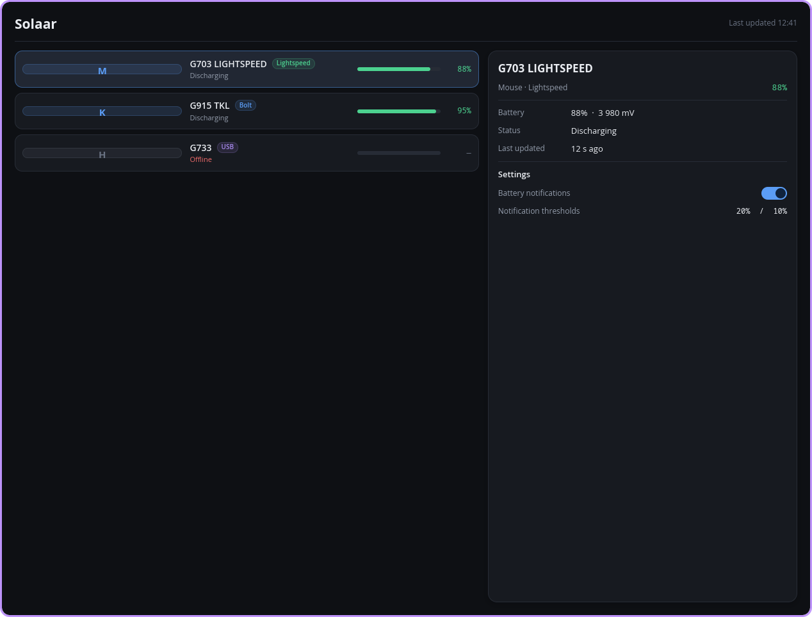

# Spike 002b — Solaar main window in **iced 0.14**

Pure-Rust, Elm-architecture GUI (wgpu renderer, no webview, no GTK/Qt).
This is the same "Devices" screen the other framework spikes build, so the look
and the numbers can be compared directly. All data is hardcoded.



*`screenshot.png` — the window-only capture (1268×964). Full screen with the
desktop around it: [`screenshot-fullscreen-wayland.png`](screenshot-fullscreen-wayland.png).*

## What is in the UI

Header (`Solaar` + `Last updated 12:41`) · three clickable device rows
(icon badge, name, connection chip **Lightspeed/Bolt/USB**, battery bar with the
percent as text, status line `Discharging`/`Offline`) · a details card for the
selected device (name, `Mouse · Lightspeed`, battery percent + mV, status,
relative last-updated, divider, **Settings** with a real `toggler` switch for
"Battery notifications" and the "Notification thresholds 20% / 10%" row) ·
dark surfaces, rounded cards, muted secondary text, a `scrollable` device list.

Two extras that are worth keeping for the comparison:

* `screenshot-glyphs-unicode.png` — the same UI with `🖱 ⌨ 🎧` in the icon badges
  instead of `M K H`. **The Unicode/emoji glyphs do render** (font fallback via
  cosmic-text, monochrome, from the system Noto/DejaVu fonts) — no tofu boxes.
  For a product you would still bundle a real icon font or SVGs.
* a live window-size subscription that prints what the compositor actually hands
  the app (see the "window size" gotcha below).

## Measurements

Every number below was produced on this machine (AMD Ryzen 7 5800X3D, 16 threads,
64 GB RAM, Mesa 26.2.4 / Radeon RX 7900 GRE, KWin 6.7.80 Wayland, scale factor 1).

| # | Metric | Value | Command / source |
|---|--------|-------|------------------|
| 1 | Cold release build | **37.9 s** wall (`user 8m30s`, `sys 0m15s`) | `cargo clean` then `time cargo build --release` |
| 1b | Cold release build, earlier identical config | 40.6 s | same |
| 1c | Incremental release rebuild (edit one file) | 30.8 s | `cargo build --release` |
| 2 | Dependency tree lines | **652** | `cargo tree --edges normal \| wc -l` |
| 2b | Unique packages in the tree | 296 (383 entries in `Cargo.lock`) | `cargo tree --edges normal --prefix none \| sort -u \| wc -l` |
| 2c | Direct dependencies in `Cargo.toml` | **1** — `iced = "0.14"` | `Cargo.toml` |
| 3 | Binary size, unstripped | **22 795 336 B** (21.7 MiB) | `ls -l target/release/solaar-iced-spike` |
| 3b | Binary size, stripped | **16 144 416 B** (15.4 MiB) — 29 % smaller | `strip -o out bin` |
| 4 | VmRSS while the window is displayed | **74 700 kB** (sample 1) and **74 700 kB** (sample 2, 5 s later); `VmHWM` 74 700 kB | `grep VmRSS /proc/<pid>/status` |
| 4b | Threads while idle | 31 | `grep Threads /proc/<pid>/status` |
| 5 | Startup → first frame buffer on the wire | **75.7 ms** (run A) / **208.6 ms** (run B) | `WAYLAND_DEBUG=1` protocol trace timestamped by `wayland_timeline.py` |
| 5b | Startup → visible change on screen | **≤ 609 ms**, i.e. the window was already up on the first ~300 ms polling cycle | screenshot + `magick compare -metric RMSE` poll loop |
| 6 | Screenshot | `screenshot.png` 1268×964, 48 140 B (PNG, RGBA) | `spectacle -b -n -a -o screenshot.png` |
| 7 | `ldd` | `linux-vdso.so.1`, `libgcc_s.so.1`, `libm.so.6`, `libc.so.6`, `ld-linux-x86-64.so.2` | `ldd target/release/solaar-iced-spike` |
| 7b | Non-standard / extra libraries | **none** — no GTK, no Qt, no X11/Wayland lib in `DT_NEEDED`, no webview, no RPATH/RUNPATH | `objdump -p`, `ldd` |
| 7c | Window title | `Devices` | `.title("Devices")`; shown as the active-window title in the panel |

Raw evidence lives next to this file: `build-release.log` (timed cold build),
`wayland-startup.log` (startup timeline + proof the native Wayland backend was
used), `run.log` (the sizes the compositor gave the window), and the probe
scripts `measure_build.sh`, `final_probe.sh`, `wayland_timeline.py`.

### Notes on the measurements

* **Startup.** The 75.7 ms / 208.6 ms spread is run-to-run variance on a machine
  that was simultaneously running five other Rust spikes' cargo builds; the trace
  run measures "first `wl_surface` buffer attached" (i.e. content handed to the
  compositor). The screen-diff method gives ≤ 609 ms, bounded by the ~300 ms cost
  of one `spectacle` + `imagemagick compare` cycle.
* **Runtime libraries are dlopen'd.** Nothing graphical is in `DT_NEEDED`, but
  `/proc/<pid>/maps` shows `libwayland-client`, `libvulkan`, `libEGL` and also
  `libX11`/`libxcb` mapped in — wgpu loads its GPU stack at runtime and winit's
  clipboard/X11 paths pull in the X client libraries. So the binary needs a
  working **Vulkan (or GL) driver** at runtime, not just glibc.
* **Memory** is ~74 MB RSS / 31 threads for this window — a GPU renderer plus a
  thread pool, so noticeably more than a GTK/Qt app of the same size, and worth
  watching for a long-running tray-resident app.
* **The window size is not what we asked for.** The app logs
  `900x560` (requested) then `1262x958` — this KWin/KineticWE desktop **tiles new
  windows**, so the requested 900×560 is overridden and the window is placed in
  the right half of the 2560×1080 screen, on Wayland *and* on XWayland alike.
  The layout is fluid (`Length::Fill` + `FillPortion`) so it adapts, but the
  screenshots show the window at 1262×958, not 900×560. `.resizable(false)` did
  not stop the tiling either. Nothing about this is iced's fault.
* **Both backends work.** The app starts natively on Wayland (verified from the
  protocol trace: 4441 Wayland messages, `BACKEND=wayland`) and also runs under
  XWayland with `WAYLAND_DISPLAY=` and `DISPLAY=:0`.
* **`spectacle -a` is not trustworthy here**: it captures whichever window has
  focus, and twice it captured a *different* application that happened to own the
  same tile. `screenshot.png` is therefore the window-only capture taken during
  the XWayland run (visually verified to be this app); the native-Wayland
  full-screen capture is included alongside it.
* **Environment gotcha (costs anyone re-running this a rebuild):** this session
  exported `CARGO_TARGET_DIR=<…/002c-egui-gui/target>`, so `cargo build` writes
  into a *sibling spike's* target directory. The final numbers above were
  measured with the binary that build produced (`sha256 ccdb06a5…`); a
  `cargo clean` in this spike removes that shared directory, not this project's.

## Verdict

**VALIDATED.** iced 0.14 builds clean (`cargo build --release`, 652-line dep
tree, 37.9 s cold, 15.4 MiB stripped, zero GTK/Qt/X11 libraries linked), runs
natively on Wayland at ~75–210 ms to first frame with 74 MB RSS, and produces the
intended modern dark UI — rounded cards, a tinted connection chip, battery bars,
muted secondary text, a highlighted selection, a scrollable list and a **real
switch widget** — with every required measurement collected. The UI source
compiled on the first attempt with no API errors.

### (a) How easy was the UI to express?

Pleasant, and very "compile-driven". State + `Message` enum + `update` +
`view -> Element`, widgets configured by chaining builders
(`container(...).padding(16).style(...)`). Styling is the only part that takes
getting used to: there is no CSS, so every surface/radius/border/shadow is a
closure returning a style struct, and helper functions (`fn card_style(...)`,
`fn device_row(...)`) are how you keep it readable. Layout is nested
`row!`/`column!` with `Length::Fill` and `FillPortion(3)/FillPortion(2)` for the
list/card split — no flexbox, no grid, but enough for this screen.

Size of the UI: **506 lines** for the whole file, **439** excluding comments and
blank lines, of which **224** are the view/widget-construction half. That is the
whole app (theme, mock data, layout, styles) — no markup, no style sheet.

### (b) Switch, scrollable list, dark/light theming out of the box?

* **Switch** — yes, first-class: `toggler(bool).on_toggle(msg).size(20)`; the
  knob/track styling is themeable through a `toggler::Style`.
* **Scrollable list** — yes, `scrollable(content).height(Length::Fill)`; a real
  scroll view with a themeable scrollbar and `on_scroll` for virtualization.
* **Theming** — yes, and the best of the candidates for this app:
  23 built-in themes (Dark, Light, Dracula, Nord, Solarized*, Gruvbox*,
  Catppuccin*, TokyoNight*, Kanagawa*, Moonfly, Oxocarbon, Ferra) **plus**
  `Theme::custom(name, Palette { background, text, primary, success, warning,
  danger })` for an exact brand palette (what this spike does), and per-widget
  style closures for anything the palette does not cover.

### (c) Blockers for a production Solaar

* **Tray icon — the real gap.** iced has no tray/StatusNotifierItem support at
  all. A tray-resident device manager would need a second crate (`ksni`,
  D-Bus-based) running next to the iced event loop — exactly the risk spike 003
  is there to test. iced's own multi-window path (`iced::daemon`) exists if you
  want a settings window in the same process.
* **Desktop notifications** — nothing built in; `notify-rust`/D-Bus, as with any
  Rust GUI.
* **File dialogs** — nothing built in; `rfd` (which drags in GTK, undoing the
  dependency purity) or the XDG portal.
* **Accessibility — the biggest long-term concern.** No AccessKit integration in
  0.14, so assistive tooling cannot see the UI; a custom widget tree has to be
  exposed by hand. None of the pure-Rust toolkits are strong here yet.
* **i18n** — no framework: text is just `String`, so gettext/Fluent integration,
  plural forms and RTL/bidi layout are all on you (cosmic-text shapes bidi
  correctly, but there is no text-direction API).
* **Icons** — no icon set; Unicode glyphs work via font fallback (verified),
  otherwise bundle an icon font (`iced_fonts`) or SVG assets.
* Minor: 31 threads / 74 MB RSS for one window, and a hard runtime dependency on
  a working Vulkan/GL stack (the binary itself links almost nothing).

## Files

| File | What it is |
|------|------------|
| `src/main.rs` | the whole app (506 lines) |
| `screenshot.png` | window-only capture of the running app (deliverable) |
| `screenshot-fullscreen-wayland.png` | native-Wayland full-screen capture, window in context |
| `screenshot-glyphs-unicode.png` | variant with Unicode/emoji icon glyphs |
| `build-release.log` | timed cold release build output |
| `wayland-startup.log` | startup timeline from the Wayland protocol trace |
| `run.log` | the window sizes the compositor actually granted |
| `measure_build.sh`, `final_probe.sh`, `wayland_timeline.py` | the probes that produced the numbers |

Build and run:

```bash
cd spikes/002b-iced-gui
cargo build --release
./target/release/solaar-iced-spike          # SPIKE_FIXED_SIZE=1 to pin the window size
```
