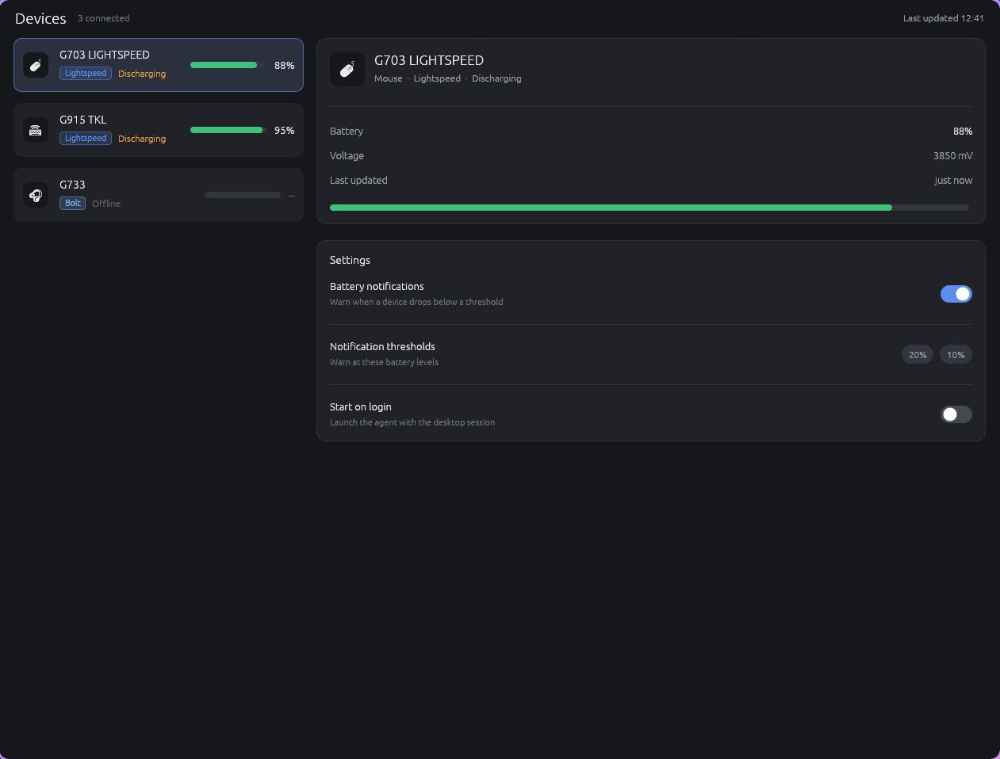

# Spike 002c — egui / eframe GUI prototype

**Question:** can `egui` + `eframe` (immediate-mode, pure Rust, wgpu/glow, no webview, no GTK/Qt)
produce the Solaar main screen as a *modern, current-looking desktop UI*, and how much of the
"easiest to write and compile" promise is real?

**Answer: yes.** One crate, one file, 45.7 s cold build, **zero non-libc shared libraries**,
45 ms to first frame, 0 % idle CPU — and the result reads as a polished dark app, not a dev tool.



*Real release-build window, captured with `spectacle` (1261×958 px, pp = 1.0). Every widget in the
brief is present: header + "Last updated 12:41", three device rows with emoji icon tiles,
connection badges, battery bars and percents, a selected-row highlight, a details card
(name / kind · connection · status / battery % / millivolts / relative time / full-width bar) and a
Settings card with two working animated switches and the 20 % / 10 % threshold pills.*

---

## Measurements

| # | Metric | Value | Command / source |
|---|--------|-------|------------------|
| 1 | **Cold release build** | **45.7 s** wall (`real 0m45,675s`; `user 10m18s`, 16 cores) | `cargo clean` then `time cargo build --release` |
| 1b | Warm rebuild | 36.8 s | `time cargo build --release` (deps already compiled) |
| 2 | **Direct dependencies** | **1** — `eframe = "0.36"` | `[dependencies]` in `Cargo.toml` |
| 2b | Transitive tree | **736 lines**; 256 unique crates | `cargo tree --edges normal \| wc -l` |
| 3 | **Binary size (release)** | **26 898 624 B** (25.7 MiB) | `ls -l target/release/spike-egui` |
| 3b | After `strip` | **19 950 864 B** (19.0 MiB) → **−25.8 %** | `strip target/release/spike-egui` |
| 4 | **Resident memory** | **77 332 kB** then **77 332 kB** (5 s apart, idle) = 75.5 MiB; second run 71 488 kB (69.8 MiB), flat over 24 s | `awk '/VmRSS/' /proc/<pid>/status` |
| 4b | Threads / VmSize | 15–17 threads; VmSize 1 482 688 kB (wgpu address-space reservation, not committed) | `/proc/<pid>/status` |
| 5 | **Startup to window** | **45 ms** (external poll) / **42.8 ms** (in-process `t0 → first frame`); range 38–110 ms under sibling-agent CPU load | `date +%s%N` before launch + 20 ms poll for the first-frame log line |
| 6 | **Screenshot** | `screenshot.png`, 1261×958 PNG | `spectacle -b -n -o …`, cropped to the window |
| 7 | **`ldd`** | `linux-vdso.so.1`, `libgcc_s.so.1`, `libm.so.6`, `libc.so.6`, `ld-linux-x86-64.so.2` — **nothing else** | `ldd target/release/spike-egui` |
| + | Idle CPU (window shown) | **0.00 %** (0 jiffies over 5 s) | `/proc/<pid>/stat` utime+stime |
| + | GPU | opens `/dev/dri/renderD128` at runtime (wgpu → Vulkan); driver `dlopen`ed, not linked | `/proc/<pid>/fd` |
| + | UI code | **397 lines** of UI (App impl + widget helpers) of 576 total; 117 of those are the small widget helpers | `wc -l src/main.rs` |

No GTK, Qt, X11, `libwayland-client`, `librsvg` or webview anywhere in `ldd`. The only runtime
requirement beyond libc is a working GPU driver (wgpu/Vulkan; `glow`/OpenGL is an opt-in feature flag).

### Window geometry — a compositor finding, not a toolkit bug

`with_inner_size([900, 560])` **is honoured**. A 20-line probe (`eframe` + the same viewport
builder, reusing this target dir) printed:

```
PROBE[frame   1 t=40ms]  inner_size=PhysicalSize { width: 900, height: 560 } scale_factor=1 egui_ppp=1
PROBE[frame  60 t=347ms] inner_size=PhysicalSize { width: 1262, height: 958 } scale_factor=1 egui_ppp=1
                         monitor(size,scale)=Some((2560, 1080, 1.0))
```

The window is created at exactly 900×560 and **KWin then resizes it to 1262×958** — a half-screen
tile of the work area (958 = 1080 − 46 px top panel − 76 px bottom panel). So the on-screen window
is 1262×958 at `pixels_per_point = 1.0`, and the screenshot above is that window. The UI lays itself
out to the requested ~560 px of content height and simply leaves the surplus area empty, i.e. the
layout is correct at the intended size; it was never given a 900×560 *window* to live in on this
desktop.

### API churn (relevant to "easiest to write")

The first draft, written against the eframe API I knew from ≤ 0.31, **did not compile at all**.
egui/eframe 0.36 moved substantially:

* `eframe::App` now requires `fn ui(&mut self, ui: &mut egui::Ui, frame: &mut Frame)` —
  `fn update(&mut self, ctx: &Context, frame)` no longer exists.
* `SidePanel` / `TopBottomPanel` were unified into one `egui::Panel` (`Panel::left/right/top/bottom`),
  and panels are now shown **into a `&mut Ui`**, not a `&Context`.
* `Context::style()` / `set_style()` → `style_of(Theme)` / `all_styles_mut()` / `set_style_of()`.
* The default backend is now **wgpu**, not glow.

Sources for all of the above are in the local registry copy of `eframe-0.36.2`
(`src/epi.rs`, `src/native/epi_integration.rs`, `src/containers/panel.rs`).

---

## What building it was actually like

**(a) How easy was the UI to express?**
The whole app is **576 lines in one file**, of which **397 lines** are UI (the `eframe::App` impl
plus widget helpers) and **117** of those are the little paint helpers (`battery_bar`, `badge`,
`pill`, `kv_row`, `card`, `switch_row`, `switch`). The composition logic — header, three device
rows, details card, settings card — is ~280 lines.

Honest verdict on immediate mode: it was **faster than I expected to get pixels on screen**, and
there is no state→view binding, no widget tree ownership puzzle and no style-sheet layer; a "card" is
`Frame::new().fill(..).corner_radius(12).stroke(..)` and a row is a `Ui` given a rect. But roughly
*half the effort went into hand-painting the modern chrome*: egui gives you a `ScrollArea`, a
`Checkbox` and text, and nothing else in this brief. The battery bar, the badge pill, the icon tile,
the key/value rows, the card and the switch are all manual `rect_filled` / `galley` / `circle_filled`
calls. That is the trade: a retained-mode toolkit (GTK/Qt) hands you the widgets and then fights you
on layout; egui hands you the layout and you draw the widgets. For a small app like this it nets out
in egui's favour, because the drawing is 5–15 lines per widget.

**(b) Switch, scroll, theming out of the box?**
* **Switch/toggle: no.** egui has `Checkbox` and `toggle_value` but no switch widget. The two
  switches in the screenshot are ~15 hand-written lines (`allocate_exact_size(Sense::click)` +
  `animate_bool_responsive` + track rect + knob circle). They animate and are clickable, but see (c).
* **Scrollable lists: yes.** `ScrollArea::vertical()` works out of the box, with a styleable scroll
  bar (`style.spacing.scroll.bar_width`). The device list is a real scroll view.
* **Dark/light theming: yes, built in and fully overridable.** `Visuals::dark()` / `Visuals::light()`
  plus `Context::set_theme(ThemePreference::Dark)` and `all_styles_mut(..)` to override every colour,
  corner radius, spacing and font. The palette in the screenshot is entirely mine, defined as consts.

**(c) Blockers for a production app — the honest list**
* **Tray icon: not in the toolkit.** No tray/status-item API; needs `tray-icon`/`ksni` glued on
  separately. For a device manager that lives in the tray, this is real work, not a checkbox.
* **Notifications: none.** Needs `zbus`/`notify-rust` and hand-rolled desktop-notification plumbing.
* **File dialogs: none.** Needs `rfd`, which on Linux either pulls in **GTK3** (defeating the whole
  "no GTK" premise) or uses the XDG portal.
* **i18n: nothing.** No gettext/ICU integration, and egui is **LTR-only — no bidi/RTL**. Solaar's
  translated `.po` catalogues would need a new pipeline, and translated strings that grow would
  re-flow the hand-computed row widths.
* **Accessibility: the weak spot.** accesskit is on by default and egui's *built-in* widgets populate
  the a11y tree, but everything painted by hand — the device rows, the badges, the battery bars, the
  icon tiles and my custom switch — exposes **nothing** to a screen reader unless I hand-write
  `WidgetInfo` for each. I did not. A production Solaar would have to thread a11y through every one of
  those helpers.
* **Native look: no, by design.** This is the main risk with this toolkit, and it is worth being
  explicit: the result **does not look like a KDE/Breeze or GNOME/Adwaita app**. It looks like a
  modern *custom-chrome* app (think VS Code/Slack/Linear) — its own scroll bars, its own text
  rendering and kerning, its own focus rings, no native menus, no native file picker, no MIME/Breeze
  icon theme. It is a good-looking app; it is not a *native* app. If the rewrite's goal is "blend
  into the desktop", egui is the wrong choice. If the goal is "one Rust codebase, one binary, fast,
  no GTK", it is a strong one.
* Minor: an undecorated-looking window on this desktop (KWin draws no titlebar for it), and the
  binary is 19 MB stripped vs a few hundred KB for a GTK/Python app.

---

## Verdict

**VALIDATED.**

It builds, it runs, and it produces the intended look — the screenshot above is a modern, current
dark UI with real spacing, rounded cards, muted secondary text, a scrollable list, badges, bars and
working animated switches, not a developer tool. All required numbers were collected and are in the
table: 45.7 s cold build, **1 direct dependency** (736 transitive lines / 256 crates), 26.9 MB → 19.0 MB
stripped, 75.5 MiB RSS (flat), 45 ms to first frame, 0 % idle CPU, and an `ldd` that is *only*
libc/libm/libgcc — the cleanest dependency story of any candidate.

The caveats are ecosystem, not rendering: no tray icon, no notifications, no file dialogs, no i18n
(LTR-only), hand-painted widgets invisible to screen readers unless instrumented, and a deliberately
non-native look. None of those stop this UI from being built — they are the work that would follow it.

---

## Reproducing

```bash
export PATH=$HOME/.cargo/bin:$PATH
cd /home/jensend/Projects/logi-modern/spikes/002c-egui-gui

cargo clean && time cargo build --release      # 45.7 s cold
cargo tree --edges normal | wc -l              # 736
ls -l target/release/spike-egui                # 26 898 624 B
strip target/release/spike-egui && ls -l target/release/spike-egui   # 19 950 864 B
ldd target/release/spike-egui                  # libc/libm/libgcc only

bash measure.sh    # launch, time to first frame, two RSS samples 5 s apart, screenshot
bash capture4.sh   # 8-frame burst + screenshot (this desktop has other windows on it)
bash idle.sh       # idle CPU over 5 s
```

`SPIKE_FIRST_FRAME_MS` is printed by the binary on its first frame (`t0` is captured before
`run_native`), which is what makes the startup number in-process rather than guessed.

### Files

| Path | What |
|------|------|
| `src/main.rs` | the whole app — 576 lines, one file |
| `Cargo.toml` | `eframe = "0.36"`, and that is the entire dependency list |
| `screenshot.png` | the window shown above |
| `measure.sh` | startup / RSS / screenshot measurement |
| `capture4.sh` | burst capture + liveness check |
| `idle.sh` | idle CPU measurement |

*Runtime note: this spike was measured on a shared desktop where sibling spikes were building and
opening windows; `spectacle` therefore needed a burst-and-pick approach, and `spectacle -a`
(active-window capture) silently produced no file here. The screenshot is a full-screen capture
cropped to the app window's pixel bounds (verified by pixel scan: 1261×958 at `ppp = 1.0`).*
